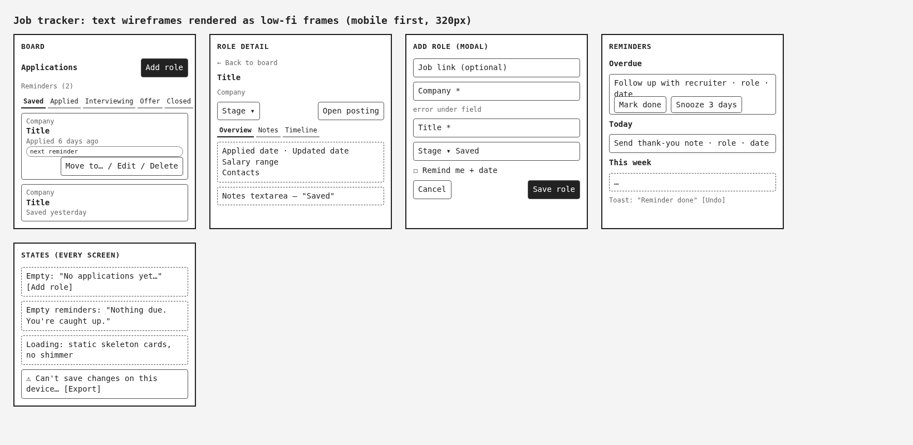
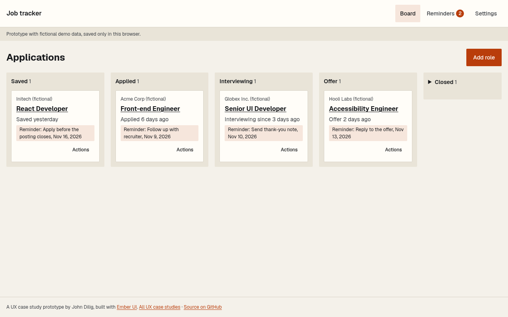
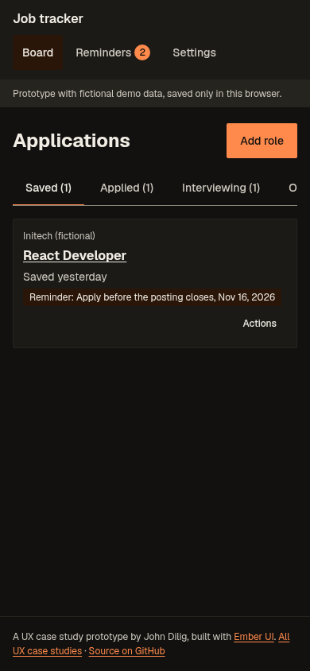
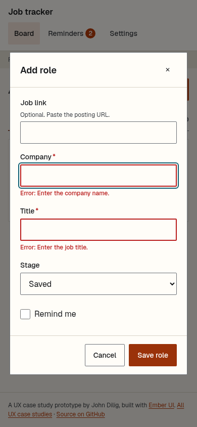
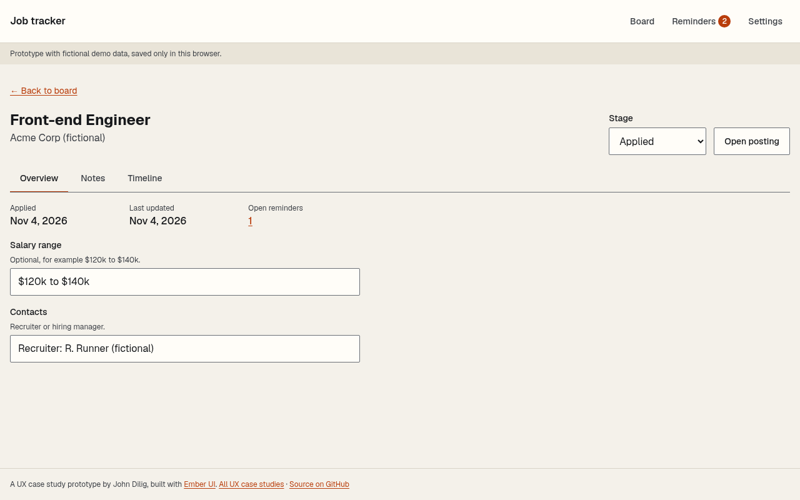
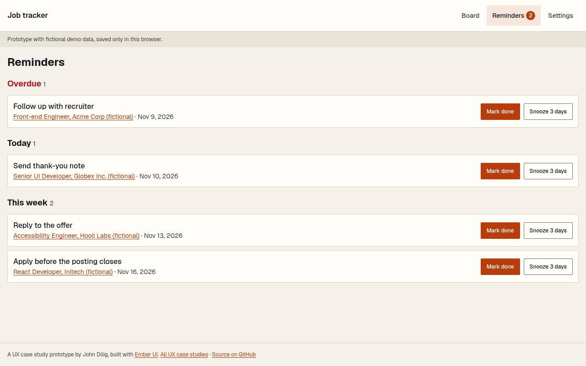
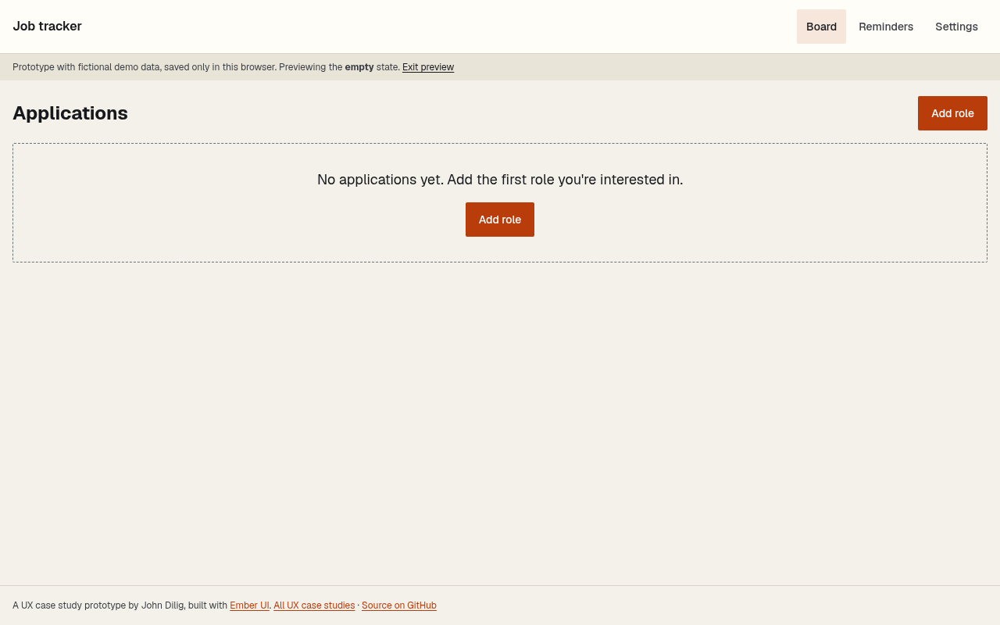
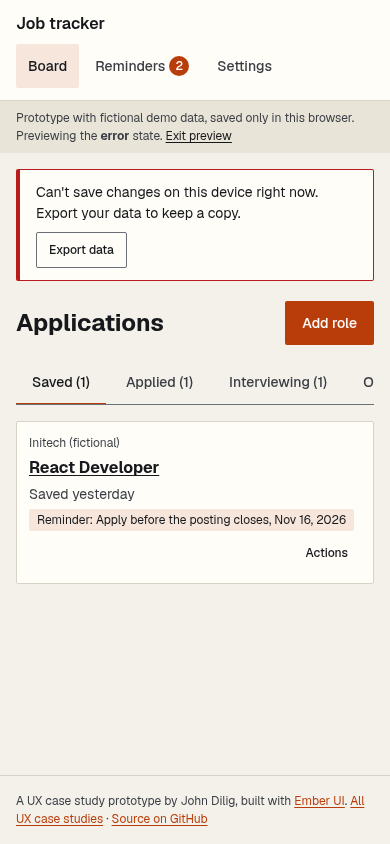

# PROGRESS: job application tracker

Dated devlog for UX Project 2. The case study's process section is written from this record.

## 2026-11-10: Spec and design
- Design spec v1.0 from Chief of Creatives: two personas (labeled Assumption), Maya's journey map, IA, text wireframes for Board, Role detail, Add role and Reminders, and required empty, loading and error states. Written up in [docs/UX.md](docs/UX.md).
- Wireframe milestone: the text wireframes rendered as low-fi frames.

## 2026-11-10: Ember UI gap found and fixed upstream
- Reminders needs "Reminder done" with **Undo**, and Ember UI's Toast had no action button. Added an optional `action` to Toast in [a11y-design-system](https://github.com/balbonits/a11y-design-system) (merge caa2f11), with a unit test and a Storybook story, instead of building a one-off toast here.

## 2026-11-10: Prototype
- Vite + React 19 + TypeScript app that used Ember UI straight from its repo at first (pinned to caa2f11, later the v0.2.x tags). Data in localStorage with fictional seed roles. Hash routing so it ships as a static folder at jdilig.me/ux/job-tracker/.
- Board: tabs below 960px, five columns above, Closed collapsed. Cards move with "Move to..." in an Actions menu. Moving to Applied, Interviewing or Offer adds a follow-up reminder (the journey map's "reminders triggered by stage").
- Role detail with Overview, autosaving Notes ("Saved" status in a live region) and Timeline. Add and Edit share one modal form with inline errors; focus goes to the first invalid field.
- Reminders grouped Overdue, Today, This week and Later, with Mark done plus Undo and Snooze 3 days. Settings has export, reset demo, state previews, and clear with confirm.
- States: empty, static skeleton loading (no shimmer), and a "Can't save" alert banner with Export, on every screen. Preview with `?state=empty|loading|error`.
- Checks: 15 unit tests pass. axe sweep of 17 screens and states x 1280/320 x light/dark = 68 runs, 0 serious or critical, no horizontal overflow. First run flagged one contrast issue (the preview-state link on the muted note bar in light mode), fixed by using body text color there.

| Board, desktop | Board, mobile dark | Add role errors |
|---|---|---|
|  |  |  |

| Role detail | Reminders | Empty | Can't save |
|---|---|---|---|
|  |  |  |  |

## 2026-11-10: Architecture review, mobile-first and keyboard pass
- Chief Architect's review asked for these, and all are done:
  - **R-1:** Ember UI now comes in as a built package from the tag `github:balbonits/a11y-design-system#v0.2.1`, with no alias into its source.
  - **R-5:** route changes act like page changes. The title updates, focus moves to the H1, a new view starts at the top, and Back restores the scroll position.
  - **R-8:** CI, an ACR and a secret scan.
- Mobile-first: all buttons use the 44px default size. Standalone links, the Closed toggle and the brand link are 44px tall. Ember UI's modal close button went from 36px to 44px upstream (v0.2.0).
- The keyboard-only e2e (`scripts/e2e.mjs`) found two real bugs:
  - The skip link went to `#main`, which the hash router read as "go to the board". It now moves focus to main without touching the route.
  - Closing the Add or Edit role dialog with Esc dropped focus to the page body, because the app unmounts the dialog. Fixed upstream in Ember UI v0.2.1 with a regression test.
- Heading order: each board stage panel now has an H2. A favicon was added.
- Checks:
  - 15 unit tests pass.
  - The e2e has 11 checks and all pass.
  - The axe sweep is now 17 screens and states x 1280, 900, 414, 375 and 320 x light and dark = 170 runs. It found 0 violations, 0 horizontal overflow and 0 controls under 44x44px.
  - Local Lighthouse scores 100 for accessibility, best practices and performance.
- [Accessibility Conformance Report](docs/ACR.md) (VPAT 2.5, 508 edition, self-assessed). It says plainly that no screen-reader pass has been done yet.
- CI on GitHub Actions runs typecheck, lint, unit tests, build, the axe sweep and the e2e on every push and PR.

## 2026-11-10 2:45 PM PT: Live on jdilig.me (v0.1.0)

- Live at https://www.jdilig.me/ux/job-tracker/, with the case study at https://www.jdilig.me/ux/job-tracker/case-study (jdilig-me-v3 merge e8f285a). The site serves the exact tag build; BUILD.json reports v0.1.0 at c449ac8.
- Live checks: axe ran 170 times (17 screens and states, at 1280, 900, 414, 375 and 320, light and dark) with 0 serious or critical issues, no page-level overflow and every target at least 44px. The keyboard e2e passes (skip link, dialog focus, focus return after Esc).
- Final screenshots are in docs/screenshots/ with the 2026-11-10-final prefix.
- Still to come: this build uses Ember UI v0.2.1. It gets retrofitted onto v0.3.0 once the theme (R-2) and motion (R-3) work lands, along with the B-1 and B-2 fixes. The screen-reader pass (Orca on Linux) and an iPhone VoiceOver follow-up are still open.

## Design log (Chief of Creatives)
_Chief of Creatives adds their entries here._

## 2026-11-10 3:16 PM PT: Ember UI v0.2.2

Bumped ember-ui to v0.2.2 (Architecture review B-1, B-2): small buttons and checkbox rows get 44px hit areas, and the Undo toast now stays until dismissed instead of timing out after 5s (WCAG 2.2.1). Unit 15/15, axe 170 runs 0 failing, e2e pass.

## 2026-11-10 5:45 PM PT: R-8 repo conventions
- Secret scan: gitleaks 8.28.0 over the full history (9 commits, up to 91cd7d1), findings redacted: **no leaks found**.
- CI now runs gitleaks on every push and PR (`.github/workflows/gitleaks.yml`, full history), next to the existing check job (typecheck, lint, test, build, test:a11y, test:e2e).
- Conventions confirmed: README, this PROGRESS.md, MIT LICENSE ("Copyright (c) 2026 John Dilig") and the ACR source at [docs/ACR.md](docs/ACR.md). History is real and unsquashed.
