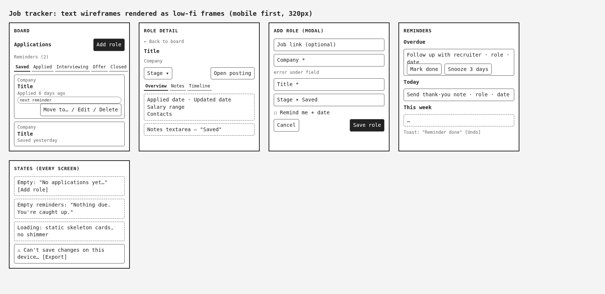

# Job tracker: UX research and design

Design spec v1.0 by Chief of Creatives, built by John Dilig's team. Nothing here comes from interviews: the personas are **assumptions** based on common job-search patterns, and they're labeled that way.

## Personas (Assumption)

1. **Maya, the active applicant (Assumption).** A mid-level front-end developer who was laid off and is applying to 10 to 20 roles a week from a laptop. She needs to see every application's stage at a glance and never miss a follow-up. Her pain: spreadsheets go stale and emails get buried.
2. **Dev, the casual looker (Assumption).** Employed, checking roles on his phone at lunch, a few a month. He needs to save a role in seconds and come back later. His pain: he loses the link and forgets why he liked it.

## Journey map (Maya)

| Step | Find role | Save it | Apply | Wait | Follow up | Interview | Offer or rejection |
|---|---|---|---|---|---|---|---|
| Feeling | hopeful | busy | busy | anxious | stressed about timing | hopeful | relieved or disappointed |

Opportunities: one-tap save, a stage change in one move, reminders triggered by the stage, and a calm "nothing due today" state.

How the prototype answers them: Add role needs only company and title; "Move to..." changes stage from the card; moving to Applied, Interviewing or Offer adds a follow-up reminder; Reminders shows "Nothing due. You're caught up." when it's empty.

## IA / sitemap

- **Board (home):** columns Saved, Applied, Interviewing, Offer, Closed. Closed collapses by default.
- **Role detail:** company, title, link, salary range (optional), stage, dates, notes, contacts, timeline.
- **Add role:** modal from the Board.
- **Reminders:** grouped Overdue, Today, This week (and Later).
- **Settings:** export JSON, reset demo data, preview states, clear data (with a confirm modal).

## Wireframes

Text wireframes from the spec, rendered as low-fidelity frames in [wireframes.html](wireframes/wireframes.html):

- **Board:** header "Applications", Add role, Reminders badge. Tabs on mobile, five columns on desktop. Cards show company, title, stage age ("Applied 6 days ago"), the next reminder, and a "Move or edit" button whose menu has Move to..., Edit and Delete. No drag-only moves.
- **Role detail:** back to board, title and company, stage select, open posting link, tabs Overview, Notes (autosave with a "Saved" status) and Timeline.
- **Add role (modal):** job link (optional), company and title (required), stage (default Saved), remind me with a date. Errors appear inline under each field.
- **Reminders:** each row has the role, what to do, the date, Mark done and Snooze 3 days. Mark done shows a toast with Undo.

## States (every screen)

- Empty board: "No applications yet. Add the first role you're interested in." plus Add role.
- Empty reminders: "Nothing due. You're caught up."
- Loading: static skeleton cards with no shimmer, so reduced motion looks the same.
- Error (storage unavailable or full): an alert banner, "Can't save changes on this device right now. Export your data to keep a copy.", with Export.

Every state can be previewed from Settings or with `?state=empty`, `?state=loading` or `?state=error`.
